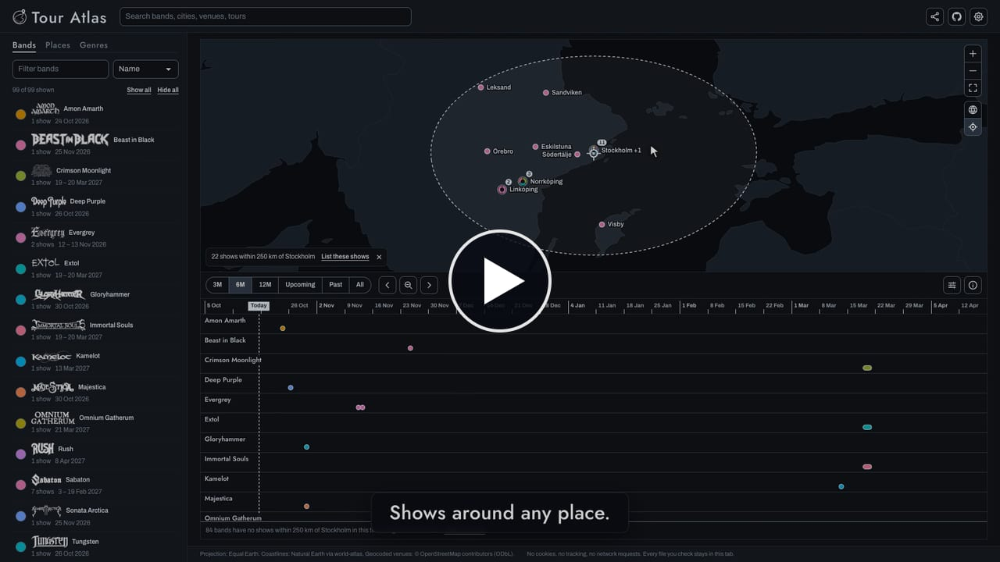

# Tour Atlas

Follow your favourite bands on tour through space and time.

Every show of the bands you follow on one world map, with a timeline right underneath: see where they play,
when, and what's coming up near you.

## Features

- **Map and timeline:** every show as a pin on a flat map or a globe, one timeline lane per band; hovering one highlights the other
- **Filters that combine:** bands, genres, a time range and an area work together, in whatever order you pick them
- **Around a place:** shows near you, around any point on the map (menu, right-click or long press) or around a city or venue
- **Follow a tour:** a band's route animates leg by leg, with a playhead on the timeline
- **Search:** bands, cities, venues, tours and festivals
- **Share:** a link to exactly what you see; social media shows a preview card
- **Mobile:** a phone layout with a collapsible sidebar; pinch to zoom, long press to pick a point
- **Keyboard and screen readers:** skip link, keyboard cursors on the map and timeline that announce each show, live announcements for results and counts, visible focus
- **Your way:** four styles in light and dark (all meet WCAG AA contrast), eight languages, local date formats, km or miles, less animation on request

## Privacy in mind

- No account, no cookies, no tracking, no analytics, nothing stored in your browser.
- "Near me" uses your location only in the open tab; it never leaves your device and never goes into a link.
- Shared links carry the view, not you: your language and format settings stay out of them.
- Band files you check are read in your browser and never uploaded.

## Static by design

Tour Atlas is a snapshot, not a live feed. The tour dates come from each band's own pages, are reviewed, and
reach the site when it is rebuilt; nothing updates on its own while you look at it. Every show links to its
source, and to tickets where the band lists them.

## Add or update a band

Tour data lives in [`data/bands/`](data/bands/), one file per band, and changes through pull requests.
See [CONTRIBUTING.md](CONTRIBUTING.md) and [docs/DATA_FORMAT.md](docs/DATA_FORMAT.md).
Building, configuring and deploying the app: [docs/DEVELOPMENT.md](docs/DEVELOPMENT.md).

## Credits

Projection: Equal Earth (Šavrič, Patterson, Jenny). Coastlines and borders: Natural Earth via
[world-atlas](https://github.com/topojson/world-atlas). Geocoding: Nominatim, © OpenStreetMap contributors
(ODbL). Fonts: League Gothic, Archivo, Jost and Charis SIL (SIL Open Font License), self-hosted via Fontsource.
GitHub mark: [Octicons](https://github.com/primer/octicons) (MIT).
Band names and logos belong to their owners; Tour Atlas is a fan project and not affiliated with any band.
All bands in `samples/` are fictional. Tour dates in `data/bands/` come from each band's `source.url`.
